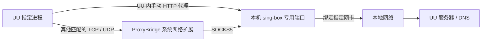

# UU Direct for macOS

让网易 UU 远程的指定进程通过本地网卡出站的**非官方、实验性工具包**。

本项目提供安装与卸载工具、专用通道配置、ProxyBridge 规则和登录启动脚本。它不修改 UU 应用本体，不修改系统代理、全局 DNS 或其他代理软件的配置，也不包含 UU、sing-box 或 ProxyBridge 的二进制文件。

**发布状态：预览版。** 原方案在 macOS 14.5 / Apple Silicon / UU 4.42.0 上验证过实际远控和一条完整的系统 DNS 往返；通用安装器尚未在全新用户环境完成验收。没有验证代理退出、系统重启、Intel Mac 或所有 VPN/网络扩展组合。不能将本项目理解为“任何代理故障都绝不影响远控”的保证。

## 工作方式



规则只匹配以下签名标识：

| UU 程序 | 签名标识 |
|---|---|
| 主程序 | `com.netease.uuremote` |
| Server | `com.netease.uuremote.server` |
| Service | `com.netease.uuremote.agent` |
| Daemon | `com.netease.uuremote.daemon` |

默认专用端口为 `127.0.0.1:18443`，只监听本机。通道出站及其自身 DNS 解析绑定用户选择的网卡。默认 DNS 服务器为 `223.5.5.5`，可以在安装时更换。

ProxyBridge 的透明扩展会先接收系统交付的流，再按应用规则决定转发；未匹配流交还系统。因此“只配置 UU 规则”并不意味着该系统组件完全看不到其他应用的流量元数据。本项目关闭 ProxyBridge 的流量记录选项。

## 使用前提

- macOS；当前实际验证环境为 **14.5、Apple Silicon**。ProxyBridge 上游要求 macOS 13 及以上，但这不是本工具包对全部系统版本的兼容性承诺。
- Python **3.10 或更新版本**。选择长期保留的 Python 安装，不要使用会随临时虚拟环境一起删除的解释器。
- 已安装并登录官方 UU 远程。
- 官方 **ProxyBridge 4.0.0 的 macOS 安装包**。系统网络扩展的批准必须由用户在 macOS 中完成。
- 官方 **sing-box 1.14.3**。本工具校验固定版本的归档和可执行文件 SHA-256。
- 一个可直接访问互联网的本地网卡。`en0` 只是示例，不保证每台 Mac 都使用它。

首版要求 ProxyBridge 专用于这四条 UU 规则。如果你已用 ProxyBridge 给其他应用分流，不要直接切换到本项目的 Profile；首版不支持合并这些规则。工具不会覆盖已有 Profile，也不会替你卸载或替换已有应用。

版本、下载链接、许可证和兼容性依据见 [第三方依赖](docs/dependencies.md) 与 [NOTICE](NOTICE.md)。

## 安装

在本仓库目录中执行以下命令。安装器仅准备文件，**不会立即启动或改变网络**。

### 1. 检查 Python 和网卡

```sh
python3 --version
networksetup -listallhardwareports
```

根据输出选择实际连接本地网络的 `enN` 接口。切换到另一张网卡后，需要重新配置和验证。

### 2. 准备官方依赖

```sh
python3 uudirect.py download-sing-box --output ./build/dependencies
```

该命令根据当前 CPU 架构选择固定版本，从官方 GitHub Release 下载并校验，然后取出指定的可执行文件；不执行下载的程序。

从 [ProxyBridge 官方 v4.0.0 发布页](https://github.com/InterceptSuite/ProxyBridge/releases/tag/v4.0.0)下载 `ProxyBridge-v4.0.0-Universal-Installer.pkg`。固定 SHA-256：

```text
df64a77b9bd1a6f9d41b4c7e2169dbf86c23441c6751b65a0a55c016a6253d0a
```

可用 `shasum -a 256` 检查安装包。安装、打开 ProxyBridge，并按 macOS 提示批准其系统网络扩展。不要为此关闭 SIP 或其他系统安全保护。

### 3. 准备专用通道与登录启动项

以下示例使用 `en0`；请替换为第 1 步确认的接口：

```sh
python3 uudirect.py install \
  --interface en0 \
  --sing-box ./build/dependencies/sing-box
```

可选参数包括 `--port`、`--dns-server`、`--uu-app` 和 `--proxybridge-app`，完整说明见 `python3 uudirect.py install --help`。

安装位置固定为当前用户的：

```text
~/Library/Application Support/UU-Direct-Community/
~/Library/LaunchAgents/local.uu-direct.community.plist
```

安装器拒绝覆盖已有安装或启动项，并检查端口冲突。它不会接管另一套 UU 通道、停止其他进程或修改其配置。如果端口已被占用，应先了解其用途，或为本项目选择另一个端口。

### 4. 导入 UU 专用规则

在 ProxyBridge 中使用 **Profile → Import Profile…**，导入：

```text
~/Library/Application Support/UU-Direct-Community/proxybridge-profile.json
```

确认活动 Profile 为 **UU Direct (community)**，且只包含四条 UU 规则和一个本机 SOCKS5 上游。使用完整 Profile 导入，不是规则列表的 Import。

### 5. 设置 UU 并启用启动项

在 UU 的代理设置中选择手动 **HTTP 代理**，地址 `127.0.0.1`，端口使用安装时选择的值，用户名和密码留空。关闭 UU 自带的登录自启动；ProxyBridge 自带的登录启动也由导入的 Profile 保持关闭。

首次应用规则时，先正常退出 UU 主程序，再执行：

```sh
python3 uudirect.py start
python3 uudirect.py status
```

`start` 提交启动请求，不代表已经完成远控验证。启动顺序为：专用通道 → 经通道检查 UU API → 核对 Profile 并启动 ProxyBridge → 检查扩展启动日志 → 打开 UU。

网络或扩展未准备好时，脚本延后打开 UU。系统扩展没有本项目可用的严格逐规则确认接口；历史日志和短暂等待是有限的检查，不是持续、绝对的隔离保障。脚本不会为了检查而强杀已经运行的 UU。

已知限制：长期运行的扩展可能因历史日志查询超时而无法通过启动检查，工具会延后打开 UU；请查看启动日志，必要时在 ProxyBridge 中手动重连扩展后重试，详见[验证说明](docs/verification.md)。

这是**登录桌面后**的自动启动，不是 FileVault 解锁前启动。UU 自身已有的官方后台服务不由本工具管理。

## 验证与故障排查

```sh
python3 uudirect.py status
```

本地日志位于运行目录的 `logs/`。`status` 的进程和启动项状态不能替代完整网络测试。建议用手机关闭 Wi-Fi、通过蜂窝网络重新连接并实际操作桌面。完整验收步骤和现有证据范围见 [验证说明](docs/verification.md)。

需要留意的边界：

- 系统代应用发出的 DNS 流需要 macOS 保留有效应用身份；原方案观察到了成功例子，并非所有解析方式均已验证。
- 通道自身 DNS 可指定服务器；被转发的 UU 原生 DNS 数据包仍可能指向系统选择的解析器。若该解析器只在 VPN 内可达，强制本地出站可能失败。
- 透明扩展默认排除 loopback。UU 改回系统代理、增加新的后台进程或签名标识变化后，需要重新检查。
- UU 或其他组件的更新、网卡切换、其他 VPN/网络扩展冲突，都可能影响结果。不要自动升级固定依赖后仍沿用旧验证结论。
- 一次成功连接不证明断线重连、开机或代理故障场景已经通过；原验证环境中的 UU 主界面仍曾显示网络异常提示。

## 停止和卸载

**先在 ProxyBridge 切离本工具的 Profile/停用其四条规则，并恢复 UU 内的代理设置**，避免 UU 继续指向已关闭的本机端口。保存其他工作后，再停止专用通道：

```sh
python3 uudirect.py stop
python3 uudirect.py uninstall
```

`uninstall` 默认只列出计划。确认列出的路径后执行：

```sh
python3 uudirect.py uninstall --yes
```

卸载只处理本工具登记的文件和当前用户的专用启动项；遇到被修改的固定文件或符号链接会拒绝删除，未知文件保留。它不会删除 ProxyBridge、macOS 系统扩展、UU、其他 Profile、其他代理软件或用户的 Python。

下载目录是单独的缓存，不会随卸载清理；确认不再需要离线重装后可自行删除。

## 开发和许可证

```sh
python3 -m unittest discover -s tests -v
python3 uudirect.py --help
```

测试使用模拟系统命令和临时目录，不应启动真实通道或改变开发机器的网络。GitHub Actions 执行相同的源码测试；它不替代真实 Mac 的安装及远控验证。

原创脚本和文档采用 [MIT License](LICENSE)。第三方软件继续适用各自许可证，见 [NOTICE](NOTICE.md)。本项目与网易、SagerNet 或 InterceptSuite 没有官方隶属或背书关系。

反馈时请提供版本、脱敏后的错误和复现步骤，不要上传完整日志、设备标识、账户资料或个人路径。参见 [贡献说明](CONTRIBUTING.md)。
